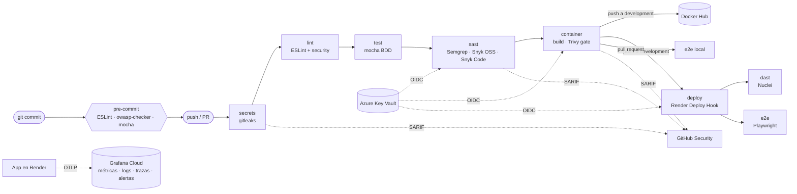

# UNA-chat · DevSecOps / SSDLC

Chat en tiempo real (Node.js + Express + Socket.IO) usado como caso de estudio para aplicar un **ciclo de vida de desarrollo seguro (SSDLC)** de punta a punta: desde hooks locales hasta despliegue continuo, pruebas dinámicas, monitoreo y gestión de secretos.

> Laboratorio 5 · Seguridad Informática · Universidad Nacional (UNA), Sede Regional Chorotega

- **App desplegada:** https://una-chat-development.onrender.com
- **Imagen:** [`bluelemon08/una-chat:development`](https://hub.docker.com/r/bluelemon08/una-chat/tags)
- **Riesgos:** [docs/matriz-riesgos.md](docs/matriz-riesgos.md) · **Tutorial:** [docs/TUTORIAL.md](docs/TUTORIAL.md) · **Demo:** [docs/PRESENTACION.md](docs/PRESENTACION.md)

---

## Pipeline

Cada push o pull request a `main` / `development` ejecuta [`.github/workflows/ci.yml`](.github/workflows/ci.yml). Los jobs están encadenados con `needs:`: si uno falla, los siguientes no corren y el PR no se puede mergear (status checks obligatorios en los rulesets de ambas ramas).



| Job | Herramienta | Bloquea si… |
|---|---|---|
| `secrets` | gitleaks (historial completo) | encuentra un secreto |
| `lint` | ESLint 9 + `eslint-plugin-security` | hay errores (p. ej. `eval`) |
| `test` | Mocha, escenarios Dado-Cuando-Entonces | falla una prueba |
| `sast` | Semgrep (`auto` + reglas propias), owasp-checker, Snyk Open Source, Snyk Code | hallazgo bloqueante / vulnerabilidad HIGH+ |
| `container` | Docker buildx + Trivy | CVE `CRITICAL` o `HIGH` en la imagen |
| `deploy` | Render Deploy Hook | Render no sirve el nuevo commit en 10 min |
| `dast` | Nuclei | hallazgo `HIGH` o `CRITICAL` |
| `e2e` | Playwright (Chromium) | falla un flujo o se ejecuta un payload XSS |

## Correr en local

Requisitos: Node.js 22+ (o Docker).

```bash
npm ci
npm start                 # http://localhost:3000

npm run lint              # ESLint + reglas de seguridad
npm test                  # pruebas unitarias BDD
npx playwright test       # E2E (levanta el servidor solo)
node scripts/owasp-checker.js --all
```

Con Docker:

```bash
docker build -t una-chat .
docker run -p 3000:3000 una-chat
```

Telemetría opcional (sin estas variables la app corre igual, sin enviar nada):

```bash
OTEL_SERVICE_NAME=una-chat
OTEL_EXPORTER_OTLP_ENDPOINT=https://otlp-gateway-<region>.grafana.net/otlp
OTEL_EXPORTER_OTLP_PROTOCOL=http/protobuf
OTEL_EXPORTER_OTLP_HEADERS="Authorization=Basic <token>"   # nunca en el repo
```

Simulación de tráfico para la demo de alertas:

```bash
node scripts/simular-ataque.js pico   https://una-chat-development.onrender.com 180
node scripts/simular-ataque.js ataque https://una-chat-development.onrender.com 150
```

## Controles por fase del SSDLC

| Fase SSDLC | Control | Herramienta | Dónde |
|---|---|---|---|
| Requisitos / Diseño | Matriz de riesgos OWASP Top 10 | — | [docs/matriz-riesgos.md](docs/matriz-riesgos.md) |
| Requisitos / Diseño | Reglas de equipo, BDD obligatorio | — | [AGENTS.md](AGENTS.md) |
| Implementación | Lint de seguridad, sin `eval` | ESLint 9 + security | `eslint.config.js`, hook pre-commit |
| Implementación | Bloqueo local de XSS/eval/SRI | owasp-checker | `scripts/owasp-checker.js`, `.husky/pre-commit` |
| Implementación | Sanitización y listas blancas (img/YouTube), render con DOM seguro | — | `libs/unalib.js`, `public/chat.js` |
| Implementación | Cabeceras (CSP, Permissions-Policy), rate limit, validación de Origin | helmet, express-rate-limit | `server.js` |
| Implementación | Inventario de componentes | CycloneDX | `docs/sbom.json` |
| Verificación | Pruebas unitarias BDD (21 escenarios, 8 de XSS) | Mocha | `test/test.js`, job `test` |
| Verificación | SAST | Semgrep, Snyk Code | job `sast` |
| Verificación | SCA (dependencias) | Snyk Open Source | job `sast` |
| Verificación | Secret scanning | gitleaks | job `secrets` |
| Verificación | Revisión de PR con IA | GitHub Copilot code review | rulesets de `main` y `development` |
| Despliegue | Imagen endurecida (alpine, no root, sin npm, HEALTHCHECK) | Docker | `Dockerfile` |
| Despliegue | Escaneo de imagen como quality gate | Trivy | job `container` |
| Despliegue | Despliegue continuo verificado por versión | Render + `/healthz` | job `deploy` |
| Verificación dinámica | DAST contra la app desplegada | Nuclei | job `dast` |
| Verificación dinámica | E2E: flujos y XSS en navegador real | Playwright | `tests/e2e/`, job `e2e` |
| Operación | Métricas, logs JSON y trazas | prom-client, pino, OpenTelemetry → Grafana Cloud | `libs/metrics.js`, `instrumentation.js` |
| Operación | Dashboard y alertas (pico de tráfico, posible ataque) | Grafana | `monitoring/grafana/` |
| Transversal | Gestión de secretos sin credenciales en GitHub | Azure Key Vault + OIDC | jobs `sast`, `container`, `deploy` |
| Transversal | Ramas protegidas, PR obligatorio, checks requeridos | GitHub rulesets | `main`, `development` |

Las evidencias de cada control (antes y después) están en [`docs/evidencias/`](docs/evidencias/).

## Estructura

```
server.js              Express + Socket.IO, cabeceras, rate limit, métricas
instrumentation.js     OpenTelemetry (se carga antes que todo)
libs/unalib.js         validación y sanitización de mensajes
libs/metrics.js        métricas prom-client + OTel
libs/logger.js         logs JSON (pino)
public/                cliente (chat.js, chat.css), sin scripts externos
test/                  pruebas unitarias BDD (mocha)
tests/e2e/             pruebas E2E (Playwright)
scripts/               owasp-checker y simulador de tráfico
monitoring/grafana/    dashboard y alertas como código
docs/                  matriz de riesgos, SBOM, evidencias, tutorial, presentación
```
